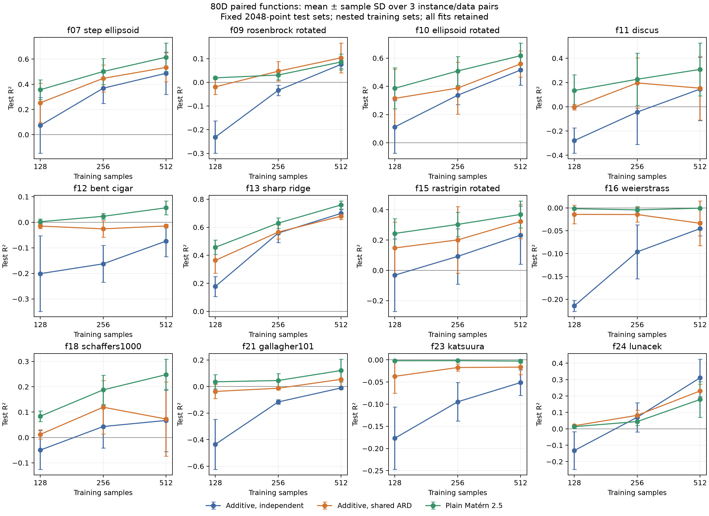
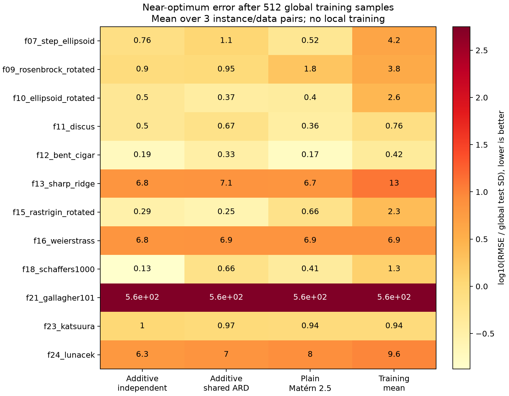

# 80 维病态黑盒函数拟合实验

## 正式运行前固定的方案

使用 IOHexperimenter **0.3.22** 提供的 BBOB 实现，完整保留函数实例的平移、旋转、
非线性变换与多峰结构，不手工重写简化公式。
BBOB 的函数分类和定义见 [COCO 官方说明](https://coco-platform.org/testsuites/bbob/overview.html)，
IOH 接口见 [get_problem 文档](https://iohprofiler.github.io/IOHexperimenter/api/ioh.get_problem.html)。
这里使用标准 BBOB 函数的 80 维实例；不是采用块旋转的 `bbob-largescale` 函数族。
这是基于这些函数的回归实验，结果不是官方 BBOB 优化器竞赛分数。

| ID | 函数 | 主要困难 |
| --- | --- | --- |
| f7 | Step-Ellipsoid | 旋转、台阶和平台、非连续变化 |
| f9 | Rosenbrock rotated | 旋转的狭窄弯曲谷地、变量耦合 |
| f10 | Ellipsoid rotated | 约百万量级条件数、旋转与非线性不规则变换 |
| f11 | Discus | 一个高度敏感方向，尺度悬殊 |
| f12 | Bent Cigar | 高条件数、窄谷与非线性不对称变换 |
| f13 | Sharp Ridge | 尖锐且非光滑的脊，方向耦合 |
| f15 | Rastrigin rotated | 旋转、非线性变换与大量局部极小值 |
| f16 | Weierstrass | 多尺度细密振荡、多峰 |
| f18 | Schaffers F7, condition 1000 | 病态尺度、振荡和变量耦合 |
| f21 | Gallagher 101 peaks | 不规则分布与不同形状的峰 |
| f23 | Katsuura | 非光滑的细尺度结构、大量局部极小值 |
| f24 | Lunacek bi-Rastrigin | 双漏斗与多峰结构 |

上述描述来自官方函数定义；条件数描述针对函数构造，不是 GP 协方差矩阵的条件数。

- 所有正式实例为 **80 维**。使用实例 1/2/3，分别配对数据种子 21001/22003/23003。
  因此三个重复同时包含实例变换和输入采样的差异，不是对同一个固定函数只更换数据种子。
- 每个实例生成 512 个训练点，三档规模取前 128/256/512 行；固定 2048 个全域测试点。
- 训练与全域测试输入在 BBOB 原坐标 `[-5,5]^80` 独立均匀采样，使用独立 RNG。
- GP 接收的输入统一除以 5，映射到 `[-1,1]^80`；输出保持原始函数值，只使用模型已有的训练目标标准化。
- 使用无噪声函数原始输出，不叠加人工噪声；三个模型仍统一保留 WhiteKernel 并优化其参数。
- 每个实例另生成固定 512 个局部测试点：`clip(xopt + Normal(0,0.1² I),-5,5)`。
  `xopt` 只供评估器构造局部测试集、核对函数实例使用，不给模型、不加入训练集。
  这衡量从全域数据预测最优点附近的能力，是分布变化下的诊断，不是局部训练后的插值测试。
- 模型与上一轮一致：独立参数加性 RBF（41 参数）、共享 ARD 加性 RBF（6 参数）、
  普通全维各向同性 Matérn 2.5（3 参数），仍使用连续四维组。
  不向模型提供旋转矩阵、敏感方向、函数 ID、实例信息、最优点或子函数标签。
- 三个方案继续使用相同初始化和参数边界，`normalize_y=true`、`alpha=1e-10`；
  L-BFGS-B 最多 500 次迭代，梯度容差 `1e-5`、函数容差 `1e-8`，单次冷启动，无先验、无重启。
  具体核设置见 [上一轮基线协议](MATERN_BASELINE_COMPARISON.md)。不根据本次测试集修改这些设置。
- 12 函数 × 3 个实例/数据配对 × 3 档样本数 × 3 个模型，共 **324 次正式拟合**。
- 每个进程一个 Eigen 线程，三个实例进程并行；保留全部拟合及未收敛状态，耗时不作为严格速度基准。
- 原始数据留在构建目录，提交生成脚本、包版本、输入及观测文件哈希、原始结果和统计报告。
  生成器检查每个实例维度、有限输出、非零方差及 `f(xopt)=fopt`；
  汇总器检查训练池、全域/局部测试校验值、完整配对和误差指标一致性。

## 误差含义

全域报告 R²、RMSE、NRMSE、MAE、绝对误差 95 分位等；不同函数值的量级差异很大，
不跨函数平均原始 RMSE。`NRMSE = RMSE / 全域测试真值标准差`，R² 越高越好。

局部同时报告原始 RMSE、局部 R²，以及 `局部 RMSE / 全域测试真值标准差`。
最后一个指标便于比较局部误差相对全域变化量有多大，不等于按局部变化量归一化。
局部 R² 的分母使用局部真值方差，可能出现非常大的负数；完整保留，不裁剪。
另记录只预测训练目标均值的局部误差作为参考。

固定加性分组通常不匹配旋转后的结构。本实验测试现有三个方案的适用性，
不是保证加性模型占优，也不单独分离核族、参数共享和加性结构各自的因果作用。
全域预测较准确与能重建最优点附近的谷地是两个独立问题。

## 复现

```bash
python3 -m pip install numpy==2.2.6 ioh==0.3.22 matplotlib==3.11.2
python3 experiments/generate_bbob_data.py --output build/bbob-data
cmake --preset release -DCMAKE_CXX_STANDARD=14 -DSUPER_GPR_BUILD_EXPERIMENTS=ON
cmake --build --preset release --target sample_learning_curve
./build/release/bin/sample_learning_curve --bbob-data=build/bbob-data/run_1 > build/bbob-run1.csv
./build/release/bin/sample_learning_curve --bbob-data=build/bbob-data/run_2 > build/bbob-run2.csv
./build/release/bin/sample_learning_curve --bbob-data=build/bbob-data/run_3 > build/bbob-run3.csv
python3 experiments/summarize_function_suite.py --bbob \
  build/bbob-run1.csv build/bbob-run2.csv build/bbob-run3.csv \
  --output experiments/BBOB_PATHOLOGICAL_RESULTS.md \
  --plot experiments/BBOB_GLOBAL.png --local-plot experiments/BBOB_LOCAL.png
```

快速检查：生成器加 `--quick`，C++ 程序同时加 `--quick`，使用 20 维开发实例、种子 101，
32/64 个训练点、128 个全域测试点、64 个局部测试点，共 72 次开发拟合。
开发数据不混入正式结果。IOH 仅为观测生成器的依赖，C++ 库与拟合程序无需链接它。

## 实测结果

拟合与数据生成代码版本为 `87c8277`，使用 Apple M4、Apple Clang 21、C++14 Release、
Eigen 3.4.0 和项目内置 LBFGS++。观测由 IOH 0.3.22、NumPy 2.2.6 生成。
36 个 80 维数据集的源文件 SHA-256 和输入一致性检查通过，版本与完整哈希记录见
[bbob_data_manifest.json](bbob_data_manifest.json)。
原始拟合记录见 [bbob_pathological_results.csv](bbob_pathological_results.csv)，
逐实例/样本数的误差、标准差、耗时和局部诊断见
[BBOB_PATHOLOGICAL_RESULTS.md](BBOB_PATHOLOGICAL_RESULTS.md)。

324 次正式拟合全部达到优化器收敛条件，未排除任何负 R² 或表现较差的实例。
收敛表示满足停止条件，不保证 LML 的全局最优，更不保证留出集预测准确。
72 次开发拟合、旧单函数数值输出兼容性检查、28 项现有测试及修改代码的 clang-tidy 均通过。

以下为 **512 个训练样本**时，三个实例/数据配对的平均全域测试 R²，越高越好：

| 函数 | 普通 Matérn 2.5 | 原独立参数加性 RBF | 共享 ARD 加性 RBF |
| --- | --- | --- | --- |
| Step-Ellipsoid | 0.6149 | 0.4873 | 0.5338 |
| Rosenbrock rotated | 0.0858 | 0.0758 | 0.1034 |
| Ellipsoid rotated | 0.6174 | 0.5157 | 0.5591 |
| Discus | 0.3083 | 0.1459 | 0.1534 |
| Bent Cigar | 0.0567 | -0.0736 | -0.0145 |
| Sharp Ridge | 0.7592 | 0.6986 | 0.6790 |
| Rastrigin rotated | 0.3696 | 0.2328 | 0.3228 |
| Weierstrass | -0.0006 | -0.0454 | -0.0337 |
| Schaffers F7, condition 1000 | 0.2477 | 0.0672 | 0.0728 |
| Gallagher 101 peaks | 0.1208 | -0.0106 | 0.0542 |
| Katsuura | -0.0027 | -0.0512 | -0.0164 |
| Lunacek bi-Rastrigin | 0.1789 | 0.3115 | 0.2310 |



按这组平均 R²，普通 Matérn 在 10/12 个函数上最高。
两个例外是旋转 Rosenbrock（共享加性最高）和 Lunacek（独立加性最高）；
但这些例外中最好的平均 R² 也只有约 0.103 和 0.312，仍不能认为已准确预测。
这里只比较三个实例的平均值，样本标准差包含实例变换和采样差异，不宣称统计显著的通用排名。

最高的平均全域 R² 出现在 Sharp Ridge，普通 Matérn 约为 0.759。
12 类函数中没有一类的最佳平均 R² 达到 0.9。
Weierstrass 与 Katsuura 上，三个模型的平均 R² 均接近或低于零，
表明当前采样预算与固定模型设置下，基本没有有效的全域预测能力。
很多函数的准确率随样本增加而改善，但改善程度有限，也存在重新拟合后的非单调变化。

### 最优点附近的误差

下面的数值为 `局部 RMSE / 全域测试真值标准差`，越低越好。
它描述局部误差相对于全域变化量的大小，不是局部相对百分比误差。
完整局部 R² 也保留在原始记录与逐实例报告中。

| 函数 | 普通 Matérn 2.5 | 原独立参数加性 RBF | 共享 ARD 加性 RBF |
| --- | --- | --- | --- |
| Step-Ellipsoid | 0.522 | 0.760 | 1.132 |
| Rosenbrock rotated | 1.837 | 0.897 | 0.951 |
| Ellipsoid rotated | 0.401 | 0.498 | 0.374 |
| Discus | 0.362 | 0.504 | 0.670 |
| Bent Cigar | 0.171 | 0.190 | 0.328 |
| Sharp Ridge | 6.676 | 6.758 | 7.075 |
| Rastrigin rotated | 0.655 | 0.292 | 0.248 |
| Weierstrass | 6.941 | 6.820 | 6.933 |
| Schaffers F7, condition 1000 | 0.413 | 0.133 | 0.664 |
| Gallagher 101 peaks | 562.154 | 561.183 | 562.025 |
| Katsuura | 0.938 | 1.039 | 0.967 |
| Lunacek bi-Rastrigin | 7.982 | 6.288 | 7.048 |



512 样本下的 108 个已拟合模型，局部 R² **全部为负**。
当前全域训练方案没有准确重建最优点附近的变化。
例如 Sharp Ridge 的 Matérn 全域 R² 为 0.759，但其局部 RMSE 仍是全域标准差的约 6.7 倍。
Gallagher 在本次全域样本上的观测变化量很小，
模型的局部误差约为 562 个全域标准差，与只预测训练均值的基线几乎相同。
这同时反映了覆盖不足和全域/局部分布差异；不能仅从此诊断分离出模型结构与样本设计各自的影响。

全域与局部的模型排序也不同。例如旋转 Rastrigin 上，共享加性模型的全域 R² 略逊于普通 Matérn，
但局部归一化误差更低；其局部 R² 仍为负，因此这不意味着已精确恢复局部振荡。

本轮没有使用局部训练、旋转学习、函数专用变换、核选择或额外重启。
结果限定于已登记的 80 维实例、128～512 个全域样本和三个固定方案。
它显示当前加性结构的适用边界，也显示普通各向同性 Matérn 对这些困难任务的预测能力有限。
