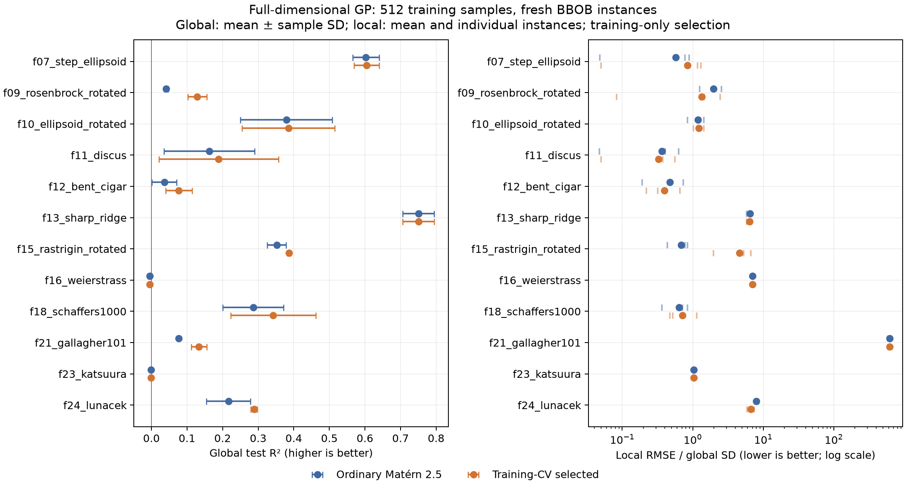

# 全维 GP 的改进：新 BBOB 实例与训练内选择

## 正式测试前固定的方案

目标是在相同训练观测预算下，检查普通全维 GP 能否提高预测精度。
继续使用 [BBOB 病态函数实验](BBOB_PATHOLOGICAL.md) 的 12 个函数和 IOH 0.3.22，
正式测试改用未使用过的实例 **4、5、6**，数据种子分别为 **31013、32003、33013**。
三个重复同时改变函数实例和输入采样，不能当作对任意函数的统计保证。

每个实例使用 512 个无噪声训练点、2048 个独立均匀全域测试点、512 个最优点附近测试点。
原坐标范围 `[-5,5]^80`，模型输入除以 5；局部测试为 `clip(xopt+N(0,0.1²I),-5,5)`。
模型只接收输入和总输出，最优点仅用于评估器构造局部测试集。
模型不使用分组、加性分解、旋转矩阵、函数特定公式或测试集调参。

五个候选方案：

| 名称 | 改动 | 超参数数目 |
| --- | --- | --- |
| baseline | 原始 `C * Matérn(ν=2.5) + White`，单起点 | 3 |
| multistart | 相同核，三个确定性起点，按训练 LML 选择最优起点 | 3 |
| quadratic | `C * Matérn(ν=2.5) + Cq * (1 + 3 x·x'/D)² + White`，三个起点 | 4 |
| asinh_matern | 训练目标做 asinh 变换，使用 multistart 核 | 3 |
| asinh_quadratic | 训练目标做 asinh 变换，使用 quadratic 核 | 4 |

二次核通过现有 C++14 模板组合 `ConstantKernel`、`DotProduct` 和乘法实现，
包含所有坐标间的二阶交互，不要求固定四维分组。
二次多项式核的性质可参考 [GPML 第四章](https://gaussianprocess.org/gpml/chapters/RW4.pdf)。
重复启动优化用于降低落入较差局部最优的风险；
[scikit-learn 文档](https://scikit-learn.org/stable/modules/gaussian_process.html) 也支持通过重启优化 LML。
这里的起点是预先指定的，不是 scikit-learn 的随机对数均匀重启。

所有模型目标标准化、`alpha=1e-10`，L-BFGS-B 最多 500 次迭代、梯度容差 `1e-5`、
函数容差 `1e-8`。幅度初值 1、边界 `[1e-5,100]`，长度尺度边界 `[0.1,100]`，
噪声方差边界 `[1e-8,0.5]`。二次项幅度初值 1、边界 `[1e-5,100]`。
三个起点的 `(长度尺度,噪声方差)` 固定为 `(1,0.001)`、`(sqrt(D/3),0.05)`、
`(2sqrt(D/3),0.2)`；其余参数不变。原始起点保留，因此同一核、同一输出变换下，
选定的训练 LML 不应低于原始起点。

### 输出变换与预测

每次拟合只用当前训练折的标签计算中心 `c`（排序后下标 `N/2` 的值）和尺度
`s=Q75-Q25`（排序下标分别为 `3N/4` 和 `N/4`）。尺度为零时使用训练标准差，
若仍为零则使用 1。变换为 `z=asinh((y-c)/s)`，适用于含负值的标签，压缩大幅值尾部。
最终全量训练时重新用全部训练标签计算变换参数。

输出预测使用反变换的条件期望，若变换空间预测为 `Z~N(mu,v)`，则
`E[y]=c+s*exp(v/2)*sinh(mu)`。
这里 `v` 使用现有 GP 的预测方差（包括 WhiteKernel），不把 `sinh(mu)` 误当成原尺度均值。
所有 CV 和测试误差都在原始输出单位上计算。
没有跨变换比较 LML；每个候选只在自己的三个起点内比较 LML。

### 训练内选择与留出评估

对 512 个训练样本按固定种子打乱，做三折交叉验证。
每个候选的目标变换、标准化和超参数优化均只使用该折的训练部分。
按三个验证折合并后的原尺度平方误差选择候选（完全相同时按表中顺序）。
选择在访问全域和局部测试预测前锁定，然后全部五个候选在 512 个训练样本上重新拟合，
同时保留每个候选和训练内选择方案的测试结果。测试集不参与模型选择。

共 `12 函数 × 3 实例 × 5 候选 × (3 CV 折 + 1 全量拟合) = 720` 次拟合，
含 1872 次 L-BFGS-B 优化启动。记录全部状态，包括达到迭代上限或线搜索失败的启动；
统计最优 LML 对应启动是否收敛，而不是将整个模型选择过程概括为一个优化器状态。
训练观测数相同，但改进方案包含更多计算，记录 CV 与最终拟合/预测耗时供参考。

正式模型、边界、变换、选择规则和新实例在测试前提交。
快速开发检查使用旧开发数据（20 维、64 样本、实例 1、种子 101），不混入正式结果。
全域与局部指标沿用上一轮定义；局部归一化误差的分母是全域真值标准差。
这轮仍是从全域训练数据向局部区域泛化，局部误差未改善时不能声称解决了最优区域拟合问题。

## 复现

```bash
python3 experiments/generate_bbob_data.py --fresh --output build/bbob-fresh
cmake --preset release -DCMAKE_CXX_STANDARD=14 -DSUPER_GPR_BUILD_EXPERIMENTS=ON
cmake --build --preset release --target full_gp_improvement
./build/release/bin/full_gp_improvement build/bbob-fresh/run_4 > build/full-improvement-4.csv
./build/release/bin/full_gp_improvement build/bbob-fresh/run_5 > build/full-improvement-5.csv
./build/release/bin/full_gp_improvement build/bbob-fresh/run_6 > build/full-improvement-6.csv
python3 experiments/summarize_full_improvement.py build/full-improvement-4.csv \
  build/full-improvement-5.csv build/full-improvement-6.csv \
  --output experiments/FULL_GP_IMPROVEMENT_RESULTS.md --plot experiments/FULL_GP_IMPROVEMENT.png
```

依赖版本同上一轮：IOH 0.3.22、NumPy 2.2.6、Matplotlib 3.11.2。
三个实例进程可并行，每个进程固定一个 Eigen 线程；耗时不是严格单进程性能基准。

## 实测结果

执行模型代码版本为 `b8c8cfc`，Apple M4、Apple Clang 21、C++14 Release、Eigen 3.4.0、
项目内置 LBFGS++。三个单线程实例进程并行运行。
新数据集版本与 SHA-256 见 [full_gp_data_manifest.json](full_gp_data_manifest.json)，
720 次拟合原始记录见 [full_gp_improvement_results.csv](full_gp_improvement_results.csv)，
全部候选、逐实例配对与耗时见 [FULL_GP_IMPROVEMENT_RESULTS.md](FULL_GP_IMPROVEMENT_RESULTS.md)。

720 次拟合包含 1872 次优化启动，全部达到优化器收敛条件。
240 次开发拟合、开发数据上 12 个普通基线与旧程序的逐值兼容性检查、
28 项现有测试和新 C++ 代码的 clang-tidy 均通过。
汇总器重新计算 CV 合并误差并核对选中候选，检查数据校验值、配对完整性、
归一化误差恒等式，以及同核多起点 LML 不低于原始起点。

### 全域预测：可以提升，但幅度有限

以下是三个新实例/数据配对的平均测试 R²。
“训练内选择”严格按照 CV 误差选型，不是从测试结果中挑最好的候选。
由于采用新实例和新采样，不能直接与上一轮实例 1/2/3 的 R² 相减；下面每一行使用配对基线。

| 函数 | 普通 Matérn 2.5 | 训练内选择方案 |
| --- | --- | --- |
| Step-Ellipsoid | 0.6028 | 0.6050 |
| Rosenbrock rotated | 0.0411 | 0.1289 |
| Ellipsoid rotated | 0.3794 | 0.3848 |
| Discus | 0.1627 | 0.1889 |
| Bent Cigar | 0.0362 | 0.0767 |
| Sharp Ridge | 0.7504 | 0.7505 |
| Rastrigin rotated | 0.3518 | 0.3865 |
| Weierstrass | -0.0047 | -0.0047 |
| Schaffers F7, condition 1000 | 0.2860 | 0.3423 |
| Gallagher 101 peaks | 0.0760 | 0.1334 |
| Katsuura | -0.0009 | -0.0009 |
| Lunacek bi-Rastrigin | 0.2163 | 0.2884 |



36 个任务中，30 个测试 RMSE 严格下降、2 个保持一致、4 个略升。
“严格下降”包含数值上很小的变化：用 1% 的 RMSE 降幅作为描述门槛，只有 18/36 个达到；
4 个退步任务的 RMSE 增幅都低于 1%。36 个配对相对 RMSE 降幅的中位数约为 0.96%，
算术平均约为 2.02%。此门槛用于解释改善幅度，不用于选择模型或排除数据。

R² 从接近零提高数倍不等于 RMSE 也降低数倍。例如旋转 Rosenbrock 的 R² 从 0.041 到 0.129，
但三个实例平均 RMSE 之比对应的降幅约为 4.7%；Schaffers F7 约为 5.4%，Lunacek 约为 4.7%。
这些难函数的绝对预测准确性仍然有限，Weierstrass 和 Katsuura 的全域预测问题没有解决。

### 哪些改动有效

单纯三起点优化的平均 R² 大多与单起点非常接近。
Bent Cigar 的一个新实例原始起点停留在几乎只预测均值的解，增加起点有所帮助，
但不能因此将其他任务的低准确率都归因于优化器陷入局部最优。

二次交互核主要改善旋转 Rosenbrock 与 Lunacek。
以旋转 Rosenbrock 为例，五个固定候选的平均 R² 分别为
`0.0411 / 0.0411 / 0.1317 / 0.0359 / 0.1336`，
对应原基线、多起点、二次核、asinh Matérn、asinh 二次核。
这里主要收益来自核结构，输出变换单独使用没有改善。

在 Schaffers F7 上，五个候选的平均 R² 为
`0.2860 / 0.2849 / 0.2892 / 0.3347 / 0.3454`，
本次改善主要来自输出变换，加入二次项进一步小幅提高。
这属于固定候选的配对消融观察，不是对所有同类函数的普遍结论。

CV 选择次数为：asinh 二次核 16、二次核 10、asinh Matérn 4、多起点 Matérn 4、原基线 2。
CV 会选错：例如 Discus 实例 6 选中了 asinh Matérn，测试 RMSE 增加约 0.45%。
因此不能把最好的测试候选当作自动选型已经达到的效果，也不能保证加入候选后测试误差单调改善。

### 局部误差：没有解决最优区域拟合

36 个选中模型的局部 R² 仍全部为负；其中 17 个局部 RMSE 比基线低。
局部改善并不随全域改善同步。以下为 `局部 RMSE / 全域测试真值标准差` 的实例平均：

| 函数 | 普通 Matérn 2.5 | 训练内选择方案 |
| --- | --- | --- |
| Step-Ellipsoid | 0.572 | 0.842 |
| Rosenbrock rotated | 1.954 | 1.332 |
| Ellipsoid rotated | 1.182 | 1.219 |
| Discus | 0.363 | 0.328 |
| Bent Cigar | 0.472 | 0.398 |
| Sharp Ridge | 6.430 | 6.429 |
| Rastrigin rotated | 0.687 | 4.625 |
| Weierstrass | 7.039 | 7.039 |
| Schaffers F7, condition 1000 | 0.641 | 0.710 |
| Gallagher 101 peaks | 615.261 | 615.219 |
| Katsuura | 1.030 | 1.030 |
| Lunacek bi-Rastrigin | 7.910 | 6.615 |

尤其是旋转 Rastrigin，全域平均 R² 改善，但局部归一化误差从 0.687 增至 4.625。
全域训练内 CV 优化的是全域误差，它没有局部标签来判断这种退化。
变换后的条件期望同时受变换空间均值与方差影响，当前结果不足以保证它在分布变化区域稳定。
因此这轮没有将输出变换或选型流程设为核心 GPR 的默认行为。

### 成本与范围

每个任务原始基线拟合及预测平均约 0.82 秒，训练内选中的最终模型平均约 5.87 秒，
另外三折验证所有五个候选平均需要约 25.62 秒。
报告全部候选的最终测试拟合还会增加实验总成本，实际只部署选中模型时不必支付这部分。
这些耗时来自三个进程并行的环境，不是严格的单进程性能比较。

结论限定于当前 512 个全域训练样本、12 个困难函数和三个新实例：
全维 GP 可以在若干任务上提高预测精度，但这组改动主要带来小到中等幅度的误差下降。
它没有解决高维数据覆盖、隐藏方向、细尺度多峰结构或最优区域外推的问题。
若后续目标是准确拟合最优区域，需要另行测试局部采样与局部模型，
并与全域方案按相同总观测预算比较；不能直接把本次全域 CV 的提升视为该目标已经实现。
