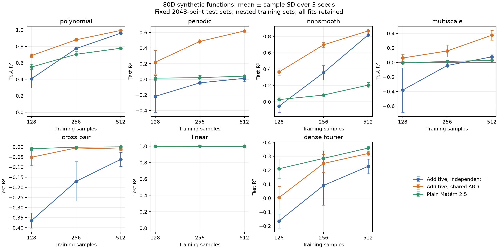

# 多函数上的 80 维 GP 配对对照

## 在正式运行前固定的方案

延续上一轮三个模型的设置：原独立参数加性 RBF（41 个参数）、共享 ARD 加性 RBF
（6 个参数）和普通全维各向同性 Matérn 2.5（3 个参数）。核、边界、初值、目标标准化、
LML 优化设置不变，具体见 [MATERN_BASELINE_COMPARISON.md](MATERN_BASELINE_COMPARISON.md)。
所有模型都仅使用整体标量标签。加性模型继续固定使用连续四维分组，不重新学习分组。
这里同时比较结构、核族与共享方案，不单独隔离加性这一因素。

- 输入独立均匀分布于 `[-1,1]^80`，种子固定为 11003、12007、13001。
- 每个种子使用一个 512 行训练输入池、一个固定的 2048 点测试集，训练、测试、噪声 RNG 独立。
- 三档训练规模为 128、256、512，取同一训练池前 N 行，噪声标签嵌套一致。
- 不同函数复用相同输入和噪声随机数；每个函数的三个模型使用完全相同的标签。
- 训练噪声标准差 0.03，测试标签无噪声。函数之间输出尺度不同，因此不跨函数平均原始 RMSE。
- 每档冷启动，不增加重启、不使用先验、不按测试结果修改模型、函数或选择最好的种子。
- 七个函数 × 三个种子 × 三档样本数 × 三个模型，共 189 次正式拟合。
- 每个进程使用一个 Eigen 线程，三个种子进程并行；保留失败/未收敛状态及所有误差。
- 校验每个函数/种子的训练池和测试集在所有模型、样本规模下保持一致。
- 汇总 R²、RMSE、NRMSE、MAE、绝对误差 95 分位、训练误差、噪声估计、耗时、LML、优化状态。

## 函数定义

这些是明确定义的合成函数，用于覆盖不同结构，不冒充标准公开基准。
令 `M=20`，第 j 个连续四维组为 `(a,b,c,d)`；除另行说明外，
目标是各组子函数之和除以 `sqrt(M)`。

| 名称 | 子函数或整体函数 | 检查的问题 |
| --- | --- | --- |
| polynomial | `0.8a + 0.6(b²-1/3) + 0.5cd + 0.4d³` | 光滑低阶多项式，组内存在交互 |
| periodic | `sin(2πa) + 0.6cos(π(b+c)) + 0.3sin(πd)` | 较快周期变化，当前 RBF/Matérn 都没有显式周期核 |
| nonsmooth | `abs(a+0.5b) + 0.6max(c,0) + 0.4abs(d)` | 带尖点、不可处处微分的加性目标 |
| multiscale | `w[sin(s(2.5a+1.2b)) + 0.6cos((3.6-s)(2c-0.7d)) + 0.5ac]`，`s=0.6+0.6(j mod 5)`，`w=0.6+0.2(j mod 5)` | 各组尺度不同，挑战共享超参数假设 |
| cross_pair | `3/sqrt(40) * sum(i=0..39) x[i]x[i+40]`，这是整体函数 | 所有乘积都跨越固定分组，加性模型无法精确表示 |
| linear | `sum(i=0..79) w[i]x[i] / sqrt(sum(w²)/3)`，`w[i]=0.5+0.2(i mod 7)`，这是整体函数 | 简单线性控制函数 |
| dense_fourier | 64 个全维随机 Fourier 特征之和，乘 `sqrt(2/64)` | 稠密跨组交互 |

Fourier 函数固定使用 `interaction_target(x,424242)`，因此不同数据种子采样同一个函数。
其频率独立服从 `N(0,(2/sqrt(80))²)`，相位均匀分布于 `[0,2π]`。
具体实现见 [problems.hpp](problems.hpp)。函数族、参数和测试方案均在正式测试前提交。

当前加性分组只对前四类及线性函数成立。后两类交互函数的结果用于显示结构失配，
不能将已知正确分组的结果推广为对未知分组、真实高维任务的普遍保证。
比较预测精度时也要同时看绝对 R²：相对更好不意味着已经准确。

## 复现

```bash
cmake --preset release -DCMAKE_CXX_STANDARD=14 -DSUPER_GPR_BUILD_EXPERIMENTS=ON
cmake --build --preset release --target sample_learning_curve
./build/release/bin/sample_learning_curve --suite > experiments/function_suite_results.csv
python3 experiments/summarize_function_suite.py experiments/function_suite_results.csv \
  --output experiments/FUNCTION_SUITE_RESULTS.md --plot experiments/FUNCTION_SUITE.png
```

正式运行分别传入 `--seed=11003`、`--seed=12007`、`--seed=13001` 并行执行，之后合并 CSV。
开发检查使用 `--suite --quick`（20 维、32/64 个训练点、128 个测试点、种子 101），
开发种子不混入正式结果。绘图需要 Matplotlib，其余数据校验与汇总只使用 Python 标准库。
旧的单函数 CSV 保持兼容；新记录增加 `function` 列。

## 实测结果与解释

模型代码执行版本为 `e04691d`。Apple M4、Apple Clang 21、C++14 Release、Eigen 3.4.0、
项目内置 LBFGS++；三个单线程进程并行。189 次正式拟合全部达到优化器收敛条件，
所有数据校验和配对完整性检查通过，没有排除负 R² 或表现较差的种子。
收敛表示满足优化器停止条件，不保证 LML 全局最优。
开发规模的 42 次拟合、原单函数输出兼容性检查、28 项现有测试及修改代码的 clang-tidy 检查均通过。

完整记录见 [function_suite_results.csv](function_suite_results.csv)，
逐种子误差、标准差、耗时与收敛结果见 [FUNCTION_SUITE_RESULTS.md](FUNCTION_SUITE_RESULTS.md)。

512 个训练样本时，三个种子的平均测试 R² 如下，越高越好：

| 函数 | 普通 Matérn 2.5 | 原独立参数加性 RBF | 共享 ARD 加性 RBF |
| --- | --- | --- | --- |
| 多项式 polynomial | 0.7773 | 0.9603 | 0.9939 |
| 周期 periodic | 0.0406 | 0.0124 | 0.6202 |
| 尖点 nonsmooth | 0.2035 | 0.8169 | 0.8665 |
| 多尺度 multiscale | 0.0289 | 0.0772 | 0.3748 |
| 跨组乘积 cross_pair | -0.00003 | -0.0623 | -0.0110 |
| 线性 linear | 0.99964 | 0.99954 | 0.99957 |
| 稠密 Fourier 交互 dense_fourier | 0.3588 | 0.2276 | 0.3200 |



前四类函数在 512 样本时，共享加性模型的每个种子都优于普通 Matérn。
这不等于四类函数均已预测准确：多尺度目标的共享模型 R² 仅约 0.375，
周期目标约 0.620，明显低于多项式的 0.994。
加性结构和参数共享在本实验中改善了样本利用率，但函数频率、组间差异、
核族和有限样本量仍会限制最终精度。

原独立参数加性模型在周期函数上只有约 0.012 的 R²，略逊于普通 Matérn。
其平均训练 RMSE 很低，而测试 NRMSE 约为 0.994，显示几乎没有有效的留出集预测能力。
因此“函数可加”本身并不保证当前拟合方案成功。
多尺度函数各组的真实尺度不同，共享模型仍优于独立模型，
但本实验不能由此确定更大样本量下的排序，也不能认为严格共享假设就是正确的真实生成机制。

在线性控制函数上，三个方案都接近真值；普通 Matérn 略好。
其 RMSE 约 0.0189，共享加性约 0.0204，原独立加性约 0.0212，
小数点后的 R² 排序没有前面几类函数那样明显的实际差距。

在稠密 Fourier 交互上，512 样本时普通 Matérn 的三个种子均胜过共享加性模型，
平均 R² 为 0.359 对 0.320，RMSE 为 0.628 对 0.646；两个方案仍有较大预测误差。
跨组乘积上，三个方案的 R² 均接近或低于零，说明它们都未学到有效预测关系。
固定分组的加性后验均值只能写成各组函数之和，无法精确表示这里的跨组乘积。
独立、零均值输入下，每个乘积对任意单组输入的条件均值都为零，
这也解释了为何正确预测这类目标需要表达跨组交互的模型结构。
普通 Matérn 虽允许交互，在本次 80 维、最多 512 样本的设置下也没有解决这个任务。

只有三个数据种子，且同一函数只采用一个固定定义；图中误差线为样本标准差，
不是对所有同类函数的置信区间。这些结果说明适用条件与失效情况，不构成通用模型排名。
