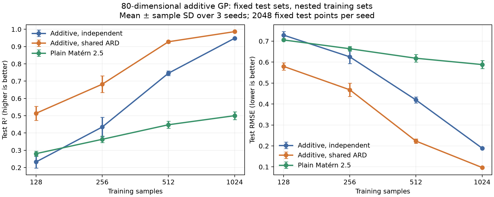

# 80 维加性 GP 与普通 Matérn 2.5 GP

## 在运行基线前固定的设置

复用上一轮学习曲线的训练池、固定测试集和噪声标签，见
[SAMPLE_LEARNING_CURVE.md](SAMPLE_LEARNING_CURVE.md)。
三个种子为 5003、6007、7001；训练样本数为 128、256、512、1024，
每个种子有 2048 个无噪声测试点，训练噪声标准差为 0.03。
所有数据校验值必须与已有加性模型记录一致。

普通模型使用整个 80 维输入上的各向同性核：

```cpp
ConstantKernel({1.0, 1e-5, 100.0})
    * Matern({1.0, 0.1, 100.0}, 2.5)
    + WhiteKernel({0.001, 1e-8, 0.5})
```

它只有幅度、一个长度尺度和噪声方差，共三个可训练参数；
不使用变量分组、加性结构、ARD、参数共享、先验或重启。
ν 固定为 2.5。长度尺度初值 1.0，各训练规模均从相同初值重新训练。
普通模型与加性模型都做目标标准化，并通过 LML 优化超参数。
沿用 `normalize_y=true`、`alpha=1e-10`、L-BFGS-B 最多 500 次迭代、
梯度容差 `1e-5` 和函数容差 `1e-8`。
不根据测试标签调整模型、初值或边界，保留所有拟合结果和收敛状态。

加性模型复用已提交的两组结果：原独立参数 RBF（41 个参数）和改进后的
共享 ARD RBF（6 个参数）。这是一组实际模型方案的对比，
同时包含加性结构与核族差异，并不单独隔离某一个因素。
测试函数本身是按已知四维组相加的函数；结论适用于这个任务，
不能推断有强跨组交互的任意高维函数也有相同排序。

## 复现

```bash
cmake --preset release -DCMAKE_CXX_STANDARD=14 -DSUPER_GPR_BUILD_EXPERIMENTS=ON
cmake --build --preset release --target sample_learning_curve
./build/release/bin/sample_learning_curve --plain-matern25 > experiments/plain_matern25_learning_curve_results.csv
python3 experiments/summarize_learning_curve.py \
  experiments/sample_learning_curve_results.csv \
  experiments/plain_matern25_learning_curve_results.csv \
  --output experiments/MATERN_BASELINE_COMPARISON_RESULTS.md \
  --plot experiments/MATERN_BASELINE_COMPARISON.png
```

生成图像需要 Matplotlib；仅校验和汇总 CSV 不需要额外 Python 依赖。
也可通过 `--seed=5003` 等参数分别运行三个种子，每个进程单线程。
不同批次的耗时受机器负载影响，本次主要比较预测精度。

## 实测结果

普通 Matérn 基线执行版本为 `4746d54`，原加性结果来自 `213f8b8` 中的 CSV。
运行环境为 Apple M4、Apple Clang 21、C++14 Release、Eigen 3.4.0 和内置 LBFGS++。
数据校验值全部一致，新增 12 次基线拟合全部收敛，合并后 36 次拟合全部收敛。
收敛表示达到优化器停止条件，并不保证找到了 LML 的全局最大值。
原始基线记录见 [plain_matern25_learning_curve_results.csv](plain_matern25_learning_curve_results.csv)，
含逐种子结果、标准差与其他误差指标的汇总见
[MATERN_BASELINE_COMPARISON_RESULTS.md](MATERN_BASELINE_COMPARISON_RESULTS.md)。

以下 R² 为三个种子的平均值，越高越好：

| 训练样本数 | 普通 Matérn 2.5 | 原独立参数加性 RBF | 改进的共享 ARD 加性 RBF |
| --- | --- | --- | --- |
| 128 | 0.2807 | 0.2328 | 0.5140 |
| 256 | 0.3635 | 0.4346 | 0.6823 |
| 512 | 0.4477 | 0.7458 | 0.9279 |
| 1024 | 0.5002 | 0.9482 | 0.9864 |

对应平均 RMSE，越低越好：

| 训练样本数 | 普通 Matérn 2.5 | 原独立参数加性 RBF | 改进的共享 ARD 加性 RBF |
| --- | --- | --- | --- |
| 128 | 0.7058 | 0.7288 | 0.5796 |
| 256 | 0.6639 | 0.6252 | 0.4680 |
| 512 | 0.6185 | 0.4195 | 0.2233 |
| 1024 | 0.5883 | 0.1894 | 0.0969 |



共享 ARD 加性 GP 在全部 12 个配对任务中优于普通 Matérn。
1024 样本时，其平均 RMSE 比普通 Matérn 低约 83.5%，
绝对误差 95 分位均值为 0.1892，普通 Matérn 为 1.1406。
原独立参数加性 GP 并非总更好：128 样本时三个种子均略逊于普通 Matérn，
从 256 样本起三个种子均超过普通 Matérn。

这与模型结构相符：普通各向同性核通过全 80 维欧氏距离判断相似度；
加性核可以在每个四维子空间分别积累相似性。
当前目标恰好具有这样的分组结构，样本增加后加性结构的收益更明显。
共享 ARD 还将自由参数从 41 个降到 6 个，但它依赖组内坐标角色可共享的假设。
因此不能把改善全部归因于“可加”，也不能推广到未知分组或强跨组交互的目标。

普通 Matérn 的训练成本更低：1024 样本平均拟合约 2.56 秒，
共享加性约 16.90 秒，原独立参数加性约 110.19 秒。
这些数据来自不同运行批次，反映本次成本量级，不作为严格的速度比基准。
